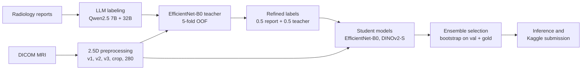

# Knee MRI Abnormality Detection with Limited Expert Labels

Kaggle notebooks for the undergraduate thesis **"Knee Abnormality Detection on MRI with Limited Expert Labels Using LLM Labeling, Teacher–Student Scheme, and Ensemble"**, developed on the [RSNA Knee Abnormality Detection](https://www.kaggle.com/competitions/rsna-knee-abnormality-detection) competition.

Of the 4,407 knee MRI studies in the dataset, only 58 have radiologist labels for the twelve abnormalities. The remaining studies come only with radiology reports written in various languages. This work:

1. extracts weak labels from the radiology reports with the Qwen2.5 LLM in a zero-shot manner,
2. refines these labels with a teacher–student scheme,
3. trains 2.5D models with attention pooling, using EfficientNet-B0, ResNet50, and DINOv2 as feature extractors, and
4. combines several models with a probability-averaging ensemble.

## Main results

| Component | Result |
|---|---|
| Combined Qwen2.5-7B + 32B labels vs. 58 expert labels | AUC 0.8465 |
| K8 ensemble (6 DINOv2-S + 2 EfficientNet-B0) vs. 58 expert labels | AUC 0.8781 |
| K8 ensemble on the Kaggle leaderboard | public 0.894, private 0.879 |

## Pipeline

## Contents of `notebooks/`

All notebooks are saved with their outputs, so every number in the thesis can be checked in the cell that prints it. Notebook numbers follow the order of the work; numbers 09 and 25 are not used. Notebook names and comments are in Indonesian.

### 1. LLM report labeling

| Notebook | Contents |
|---|---|
| `rsna-knee-01-label-reports` | First labeling of all reports with Qwen2.5-7B-Instruct (initial prompt) using vLLM |
| `rsna-knee-01b-llm-size-test` | Comparison of prompts and Qwen2.5 sizes (7B, 14B-AWQ, 32B-AWQ) against the 58 expert labels, with paired bootstrap |
| `rsna-knee-01c-relabel-32b` | Relabeling of all reports with Qwen2.5-32B-Instruct-AWQ |
| `rsna-knee-01d-label-ensemble` | Averaging of the 7B and 32B labels into the final report labels |

### 2. MRI preprocessing

| Notebook | Contents |
|---|---|
| `rsna-knee-02-preprocess-mri` | Data v1: 3 views × 16 slices × 224 px |
| `rsna-knee-02b-preprocess-mri-v2` | Data v2: 5 views × 16 slices × 256 px |
| `rsna-knee-02c-preprocess-v3-part0` and `part1` | Data v3: 5 views × 32 slices × 224 px, split into two parts due to the Kaggle output limit |
| `rsna-knee-12-cek-irisan` | Check of the original number of slices per view |
| `rsna-knee-21-cek-kiri-kanan` | Check of DICOM tags and text to determine the knee side |
| `rsna-knee-22-sisi-lutut` | Knee side (left/right) of each study for left–right normalization |
| `rsna-knee-27-preprocess-crop` | Crop data: images enlarged and then center-cropped |
| `rsna-knee-28-preprocess-280` | Data at 280 px resolution |
| `rsna-knee-31-preprocess-crop280` | Crop 280 data: enlarged to 360 px and then cropped to 280 × 280 px |
| `rsna-knee-35-jumlah-irisan` | Slice-count statistics for all series and the selected series |

### 3. Initial models and backbone comparison

| Notebook | Contents |
|---|---|
| `rsna-knee-03-train-baseline` | EfficientNet-B0 baseline on data v1 |
| `rsna-knee-03b-train-dinov2-r50` | DINOv2-S without LLRD and ResNet50 |
| `rsna-knee-03c-train-dinov2-v2` | DINOv2-S on data v2 and EfficientNet-B0 with seed 7 |
| `rsna-knee-13-cek-memori` | GPU memory check for each backbone and batch size |
| `rsna-knee-18-dinov2-base` | DINOv2-B and DINOv2-S with seeds 7 and 11 |
| `rsna-knee-37-cek-jumlah-fitur` | Check of the number of features extracted by each backbone |

### 4. Teacher–student scheme

| Notebook | Contents |
|---|---|
| `rsna-knee-06-tahapc-teacher-oof (v1 ...)` | 5-fold EfficientNet-B0 teacher (out-of-fold predictions) with 7B labels |
| `rsna-knee-06-tahapc-teacher-oof (v2 ...)` | 5-fold EfficientNet-B0 teacher with combined 7B + 32B labels |
| `rsna-knee-07-tahapc-student` | EfficientNet-B0 students on data v1 and v2 |
| `rsna-knee-08-student-dinov2-v2data` | DINOv2-S student on data v2 and EfficientNet-B0 student with seed 7 |
| `rsna-knee-10-student-v3` | Students with combined labels and the second teacher |
| `rsna-knee-14-student-d32` | DINOv2-S and EfficientNet-B0 students on data v3 (32 slices) |
| `rsna-knee-16-student-diverse` | DINOv2-S students with LLRD on data v1, v2, and 32 slices |
| `rsna-knee-20-teacher-dinov2-kf` | Test of a 5-fold DINOv2-S as an alternative teacher |
| `rsna-knee-23-dinov2-lat` | Students with left–right normalization |
| `rsna-knee-24-lat-v2-d32` | Left–right normalization on data v2 (DINOv2-S and EfficientNet-B0) and 32-slice data (DINOv2-S) |
| `rsna-knee-29-dinov2-crop-280` | DINOv2-S students on crop and 280 px data |
| `rsna-knee-32-dinov2-crop280` | DINOv2-S students on crop 280 data |
| `rsna-knee-35-ablasi-tanpa-guru` | Ablation: DINOv2-S students without the teacher, seeds 42 and 7 |
| `rsna-knee-36` | Ablation without the teacher with seed 11, and EfficientNet-B0 with the same settings as DINOv2-S (controlled comparison) |

### 5. Ensemble analysis

| Notebook | Contents |
|---|---|
| `rsna-knee-05-ensemble-analysis (v2)`, `(v3)`, `(latest)` | Analysis of early ensemble combinations on validation and gold data |
| `rsna-knee-19-analisis-fusion (v1)` | Analysis of 11 models, check of report availability in the test data, and test of combining image predictions with LLM labels |
| `rsna-knee-19-analisis-fusion (v2)` | Test of adding the 5-fold DINOv2 |
| `rsna-knee-19-analisis-fusion (v3)` | Test of models with left–right normalization |
| `rsna-knee-19-analisis-fusion (v4)` | Full analysis of left–right normalized models |
| `rsna-knee-19-analisis-fusion (v5)`, `(v6)` | Analysis of crop and 280 models |
| `rsna-knee-19-analisis-fusion (v7)` | Test of candidate ensembles against the reference ensemble |
| `rsna-knee-19-analisis-fusion (v8)` | Bootstrap CIs, three-seed ablation, and controlled backbone comparison |
| `rsna-knee-19-analisis-fusion (v9)` | Test of the ensemble against the best single model |

### 6. Inference and submission

| Notebook | Ensemble | Public LB |
|---|---|---|
| `rsna-knee-04-inference` | Single EfficientNet-B0 | 0.842 |
| `rsna-knee-04b-inference-ensemble` | EfficientNet-B0 ×2 + DINOv2-S | 0.871 |
| `rsna-knee-04c-inference-final` | Teacher and students added (version 2); two data v2 students (version 4) | 0.873; 0.877 |
| `rsna-knee-11-inference-v3` | Four student models | 0.877 |
| `rsna-knee-15-inference-final` | Six models from data v1, v2, v3 | 0.884 |
| `rsna-knee-17-inference-final8` | Eight models (D) | 0.887 |
| `rsna-knee-26-inference-lat` | With left–right normalization | 0.889 |
| `rsna-knee-30-inference-res (v1)`, `(v2)` | Crop and 280 models added (G1) | 0.891 |
| `rsna-knee-33-inference-h1` | H1 (final submission) | 0.893 |
| `rsna-knee-34-inference-k8` | K8 (final submission) | 0.894 |

## Notes

- The notebooks were run on Kaggle; the labeling and training notebooks used 2× T4 GPUs. Each notebook uses outputs of earlier notebooks as inputs (e.g., training scripts, preprocessed volumes, and label files), so they should be run in notebook-number order.
- The competition data is not included in this repository and can be downloaded from the Kaggle competition page in accordance with the competition rules.
